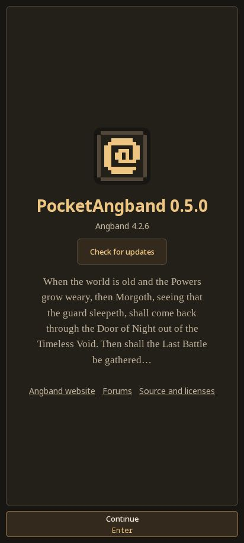
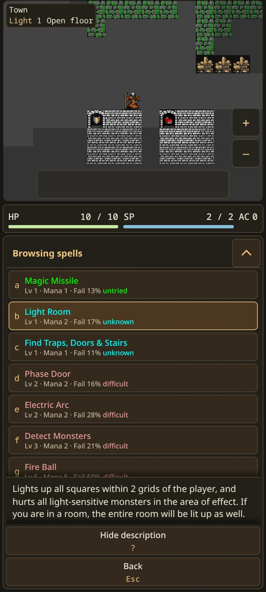
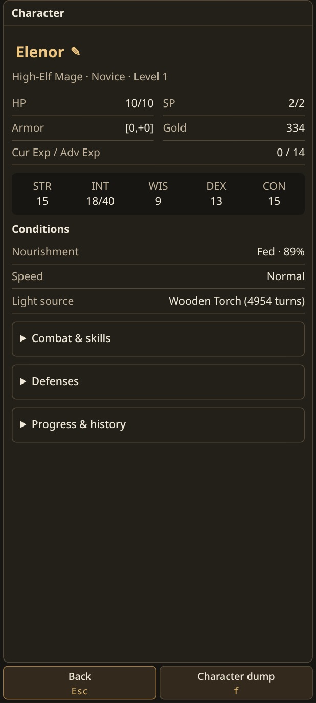
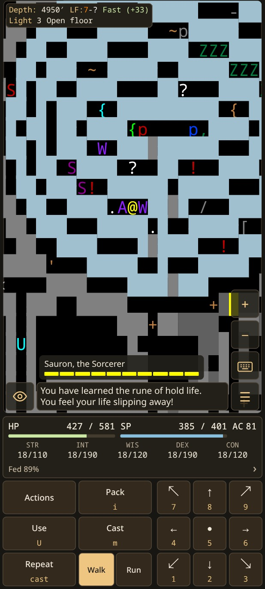
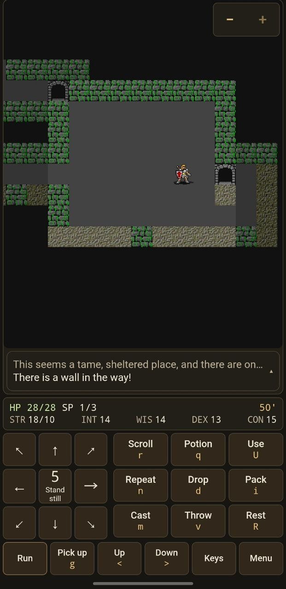
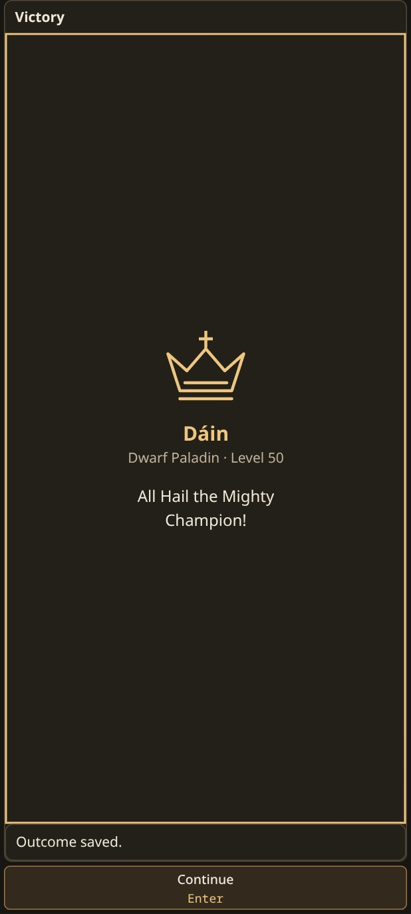

# PocketAngband

PocketAngband brings the classic single-player dungeon roguelike [Angband](https://rephial.org/) to iPhone and Android. It runs the original Angband 4.2.6 engine in the browser with a portrait layout, touch controls, and a choice of ASCII or tiles. Download the game once and play offline.

PocketAngband’s ideas were inspired by [PocketZot](https://github.com/pocketzot/pocketzot).

<p>
  <a href="screenshots/hello.jpg"></a>
  <a href="screenshots/spellbook.jpg"></a>
  <a href="screenshots/character.jpg"></a>
</p>

<p>
  <a href="screenshots/ascii.jpg"></a>
  <a href="screenshots/tiles.jpg"></a>
  <a href="screenshots/victory.jpg"></a>
</p>

## Play on GitHub Pages

1. [Open PocketAngband](https://eugene-lesnov.github.io/pocketangband/) on your phone and wait for the first download to finish.
2. Start a new game or select an existing character. You can also add PocketAngband to your home screen from the browser menu or share sheet.
3. Use **Menu → Save and quit** to save your progress. Saves are stored in your browser, so keep the site's data when clearing browsing history.

## Run a release locally

Download `pocketangband-web.zip` from [GitHub Releases](https://github.com/eugene-lesnov/pocketangband/releases) and run these commands with Python 3 from the download directory. Use an empty or absent `dist/`.

```sh
python3 -m zipfile -e pocketangband-web.zip dist
python3 -m http.server 8749 --bind 127.0.0.1 --directory dist
```

## Build and run locally

On Linux, you'll need Git, Bash, GNU Make, GNU tar, Python 3.11 or newer, and Emscripten 4.0.7. Install and activate that SDK version in your build shell. [Emscripten setup instructions](https://emscripten.org/docs/tools_reference/emsdk.html#how-do-i-install-a-specific-version)

```sh
git clone https://github.com/eugene-lesnov/pocketangband.git
cd pocketangband
bash build.sh
python3 serve.py
```

`build.sh` downloads the pinned Angband tag from GitHub and verifies its commit. For an offline build, pass a local checkout containing that commit with `bash build.sh /path/to/angband`.

The release's `pocketangband-source.tar.gz` already includes Angband. Run `bash build.sh` from the extracted source directory, then use the `http.server` command above to serve `dist/`.

Build into an empty or absent `dist/`, then [open PocketAngband locally](http://127.0.0.1:8749/).
